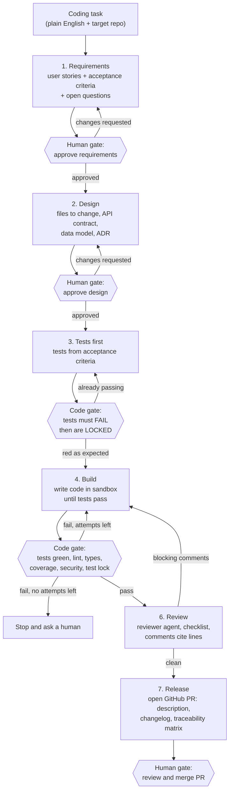
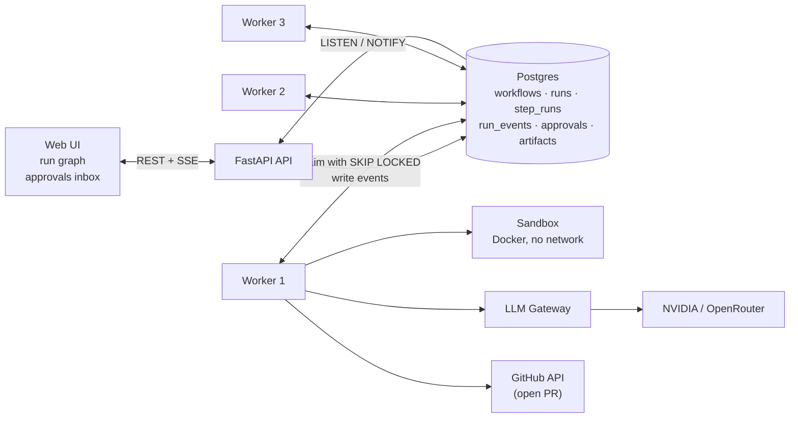
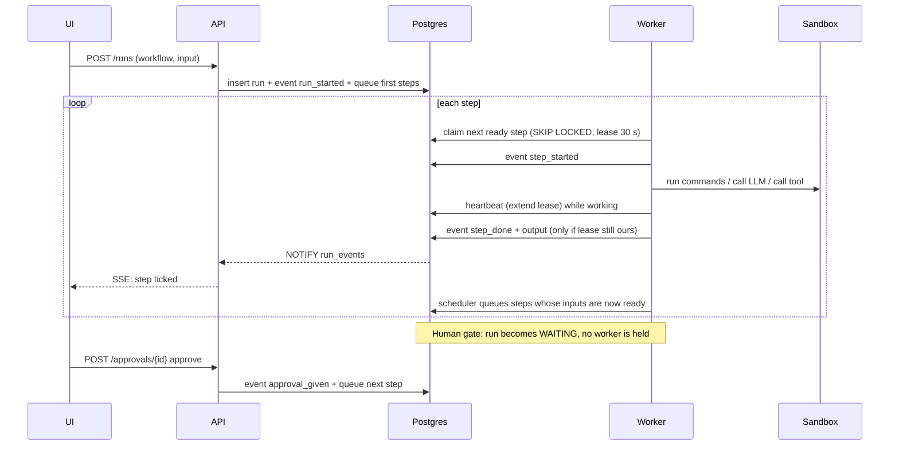
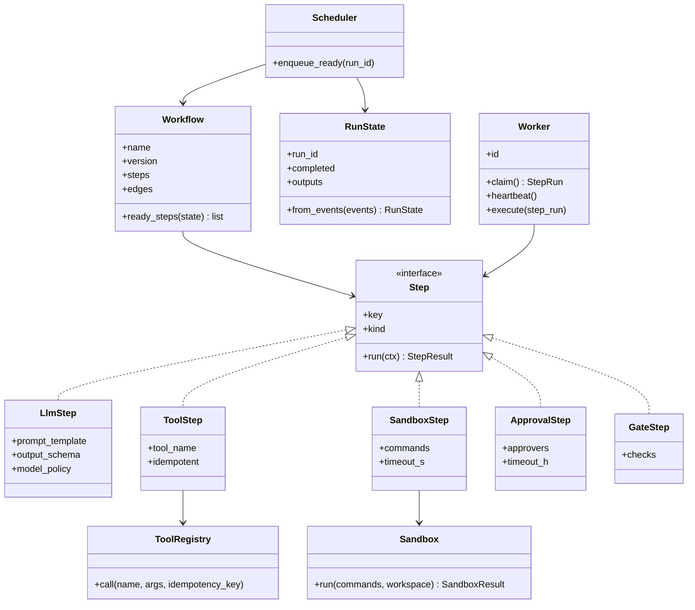
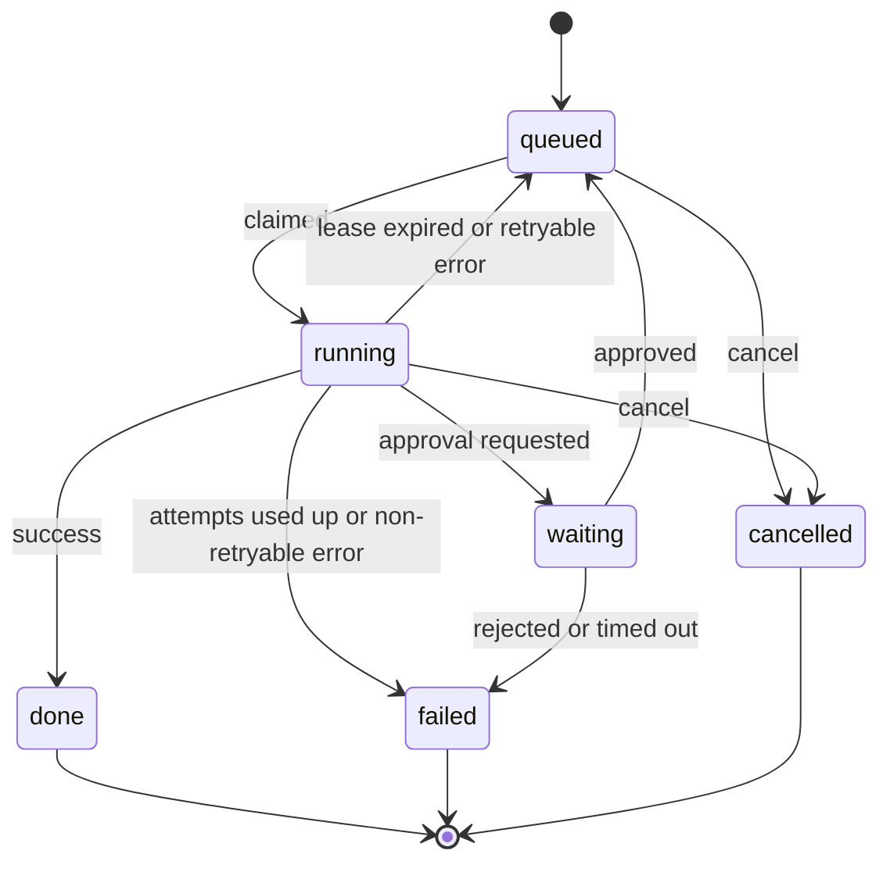
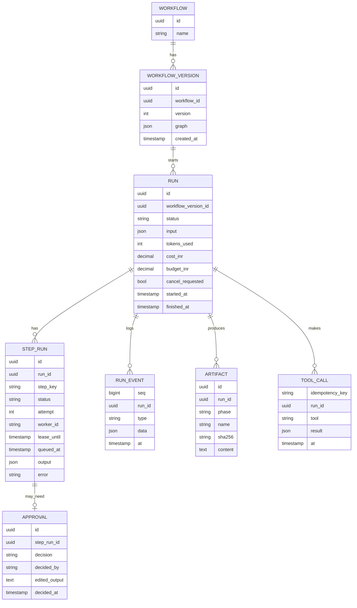
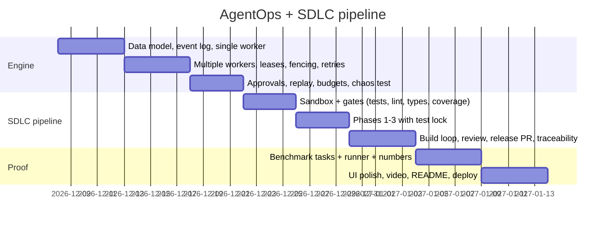

# AgentOps: everything about the project

> **Status:** milestone 1 (the durable engine) and milestone 2 (the SDLC pipeline) are **built and tested**: see section 0. The ShopLite coupon task has run live on NVIDIA Nemotron and merged (7 Nov 2026), and a demo video of that run exists. The benchmark (sections 8.1–8.3) and a real GitHub PR are **not built yet**.
> Numbers in section 0 are measured; every other number in this file is a target until measured.

---

## 0. Progress

### Built (milestone 1: the engine)

| Piece | Where | Proven by |
|---|---|---|
| Event log + projection in one transaction | `engine/runs.py`, `engine/schema.sql` | `test_status_rebuilt_from_events_matches_the_tables` |
| Postgres queue with `FOR UPDATE SKIP LOCKED` | `runs.claim` | `test_concurrent_workers_never_run_the_same_step_twice` |
| Leases, heartbeats, takeover of a dead worker's step | `runs.claim`, `runs.heartbeat`, `engine/worker.py` | `test_dead_worker_step_is_reclaimed_...`, chaos test |
| Fencing (late results from an old attempt are discarded) | `runs._own` | same test |
| Poison-step limit | `runs.claim` | `test_step_that_keeps_killing_workers_gives_up` |
| Retries with backoff; fatal vs retryable errors | `runs.fail_step` | `test_transient_errors_...`, `test_fatal_error_...` |
| Idempotent side effects (key passed to the external API) | `engine/context.py` `call_tool` | `test_side_effect_happens_once_...`, chaos test |
| Human approval that holds no worker | `runs.request_approval`, `runs.decide_approval` | `test_big_invoice_waits_...` |
| Conditions (skip a step), fan-out / fan-in | `engine/workflow.py`, `runs.advance` | invoice and chaos workflows |
| Cancel (stops a running step at its next heartbeat) | `runs.cancel_run` | `test_cancel_stops_a_running_step` |
| Replay from any step, upstream outputs reused | `runs.replay_run` | `test_replay_reuses_earlier_steps_...` |
| Validated LLM output (pydantic schema, retry with the error) | `Worker.llm` | `test_invalid_model_reply_...` |
| Budget per run | `runs.complete_step` | `test_budget_is_enforced` |
| Workflow versioning (in-flight runs keep their version) | `runs.ensure_workflow` | `test_changing_a_stored_workflow_version_...` |
| API + live event stream (SSE woken by LISTEN/NOTIFY) | `api/main.py` | `tests/test_api.py` |
| Run UI: live graph with ticks, event log, approvals (shows only the ShopLite task since 5 Nov 2026; the kill-a-worker panel was removed to keep the demo simple) | `api/static/index.html` | checked in the browser |
| Chaos test: real worker processes hard-killed at random | `tests/chaos/test_chaos.py` | `results/chaos.json` |

Engine test workflows (not shown in the UI): **invoice approval** (LLM extract → rules → human approval if > ₹50,000 or unknown vendor → post to ledger once → LLM summary) and **chaos** (fan-out with one side effect). Worker kills are shown with the chaos test and `docker compose kill worker2`, not in the UI.

### Built (milestone 2: the SDLC pipeline)

| Piece | Where | Proven by |
|---|---|---|
| 12-step workflow: load repo → requirements → approve → design → approve → tests first → build ⇄ gates → review → open PR → approve merge → merge | `sdlc/workflow.py` | `test_task_goes_from_requirements_to_merged_code` |
| Loops in the engine: a failed gate rewinds a step and everything after it, with the evidence as feedback, within a loop budget | `runs.rewind`, `runs.gate_failed` | same test (the first build is wrong on purpose and gets sent back) |
| "Request changes" at any approval, with a note the model sees next round | `runs.decide_approval` | `test_request_changes_sends_requirements_back_with_the_note` |
| Loop budget runs out → the run stops and asks a person | `runs.gate_failed` | `test_gate_loop_budget_runs_out_and_a_person_must_look` |
| Docker sandbox: no network, read-only, 512 MB, 1 CPU, 256 processes, non-root, no capabilities, hard timeout | `sdlc/sandbox.py`, `sandbox/Dockerfile` | checked by hand: network unreachable, workspace read-only |
| Red gate: every acceptance criterion needs a test that fails before code exists (tests of existing behaviour may pass); tests with no assert are rejected; then all are hashed and locked | `gates.red_check`, `gates.tests_without_checks` | `test_red_gate_rejects_tests_that_already_pass`, `test_red_gate_allows_regression_tests_next_to_a_failing_one`, `test_red_gate_rejects_placeholder_tests_before_running_them` |
| Quality gates: test lock, scope lock, protected files, secrets, syntax, pytest, changed-line coverage ≥ 80%, ruff, mypy, bandit | `gates.quality_check` | `test_quality_gate_catches_tampering_...`, `test_quality_gate_flags_lint_types_...` |
| Review comments must point at a real changed line, or they're dropped | `check_review` | full-pipeline test (one ungrounded comment dropped) |
| Traceability matrix from real per-test coverage: criterion → tests → changed lines they ran | `traceability`, coverage `dynamic_context = test_function` | `test_traceability_maps_...` and the full-pipeline test |
| Pull request written locally (PR.md + changes.patch), merged repo written on approval | `sdlc_publish_local`, `sdlc_merge_local` | full-pipeline test |
| UI: one page for the ShopLite task (see the shop → build it → open the new shop), live step graph, documents (requirements, design, gate report, diff, review, PR), approvals with Request changes | `api/static/index.html` | checked in the browser |
| **ShopLite demo**: a small FastAPI shop with a one-page frontend; the coupons task changes backend and page, with an offline replay whose first build is wrong on purpose | `sdlc/examples/shoplite`, `sdlc/fakes_shoplite.py` | `test_shoplite_gets_discount_coupons_frontend_and_backend`; run by hand in the browser on 5 Nov 2026 |
| "Open the shop": runs the original example or a run's merged code in the sandbox image on `127.0.0.1:8830` | `sdlc/preview.py`, `POST /api/examples/{name}/preview`, `POST /api/runs/{id}/preview` | checked in the browser (coupon applied, order placed) |
| Workflow version 6: requirements must use data that exists in the repo; tests must assert; each acceptance criterion needs a failing test | `sdlc/prompts.py`, `sdlc/gates.py` | the red-gate tests below; live run 3 on 7 Nov 2026 |
| **Demo video** of live run 3: portrait 1080×1350 MP4, 3:11, captions burned in, model wait time sped up 4–20× and labelled. Four captions and one stat label were corrected after recording so they match the run (the script had read the crossed-out total, missed one checks panel and summarised the review wrongly). | `results/video/agentops-linkedin.mp4` (git-ignored); made with `tools/video` (Playwright frame capture + animated overlay, ffmpeg build with sped-up waits, caption patching). The recorder now handles the cases it got wrong, and it waits for a person when review comments are escalated. | watched frame by frame against the run's events; the moved recorder re-checked with an offline run |

### Measured

Chaos test, 4 Nov 2026: `CHAOS_RUNS=500 pytest -m chaos -s`. Three worker processes were hard-killed at random (TerminateProcess, no cleanup) about once a second and restarted 1 s later. Lease: 2 s. Raw output is in `results/chaos.json`.

| Metric | Result |
|---|---|
| Runs | 500 (2,000 steps) |
| Workers killed | 435 |
| Steps taken over from a dead worker | 361 |
| **Runs lost** | **0** (500 / 500 done) |
| **Duplicate side effects** | **0**. 59 repeated requests reached the ledger after kills; the idempotency key deduped every one. |
| Missing side effects | 0 |
| Takeover time after a kill | median 1.91 s, p95 2.36 s (≈ the 2 s lease), max 10.3 s |
| Extra attempts per step | 0.18 |

Caveats: it used the offline fake model, and the test steps sleep 0.1–0.6 s on purpose so kills land mid-step, so this is a durability test, not a throughput benchmark. The 10.3 s maximum is probably a kill that landed while the other workers were also down or restarting; I haven't confirmed that.

**Live SDLC runs**, 4 Nov 2026: the refunds task on `examples/shop`, NVIDIA `nemotron-3-ultra-550b-a55b` (free tier), approvals skipped so they ran unattended. One run per change, so these are debugging runs, not a benchmark.

| Run | Result | What it showed | Fix |
|---|---|---|---|
| 1 | Failed after 5 review rounds (5.7 min, 63.5k tokens) | The code passed all 9 gates every round. The AI reviewer invented a crash the tests disproved, and flip-flopped on float rounding (add a tolerance, then "the tolerance is wrong"). | The reviewer sees its own earlier rounds; a blocking comment needs a concrete failing scenario; after 3 rounds, open comments go to the person at the merge approval instead of failing the run. |
| 2 | Failed at tests first (2.5 min) | Replies were cut off at the 2,048-token output limit in the middle of the test file. | Default limit 8,192; a cut-off reply is retried with double the room (up to 16,384) instead of being re-validated. |
| 3 | **Done** (4.0 min, 45k tokens) | Requirements → design → tests (red, locked) → build → 9 gates green → PR → merged. 16 tests, 100% of changed lines covered, 8 criteria traced to tests and lines. The tests gate wrongly rejected `TestClass.test_x` names once; the reviewer repeated the same non-bug (a 1-cent rounding case that doesn't over-refund) for 4 rounds before escalating into the PR's "Needs your decision" section. | Qualified test names accepted; a reviewer repeating last round's blocking comments word for word now escalates at once. |

**Live ShopLite runs**, 7 Nov 2026: the coupons task, same model, with a person approving (driven by a recording script for the demo video). One run per change again.

| Run | Result | What it showed | Fix |
|---|---|---|---|
| 1 | Failed at tests first (4 rounds, ~4 min) | The model's requirements used prices no product has (₹100, ₹500), so it wrote 5 placeholder tests whose body was only `pass`. The red check correctly rejected them each round, and the model never changed them. | Requirements must use data that exists in the repo; tests must assert; a test with no `assert`/`pytest.raises` is rejected before it runs, with the test named in the feedback (workflow v5). |
| 2 | Cancelled at tests first, round 3 | Two good regression tests ("no coupon → total unchanged") pass on today's code, and the old rule rejected any new test that passes. | The rule is now: every acceptance criterion needs at least one test that fails now; tests of existing behaviour may pass (v6). |
| 3 | **Done** (5.5 min) | Red check passed first time: 9 tests fail, 2 regression tests pass, all locked. Build 1 failed one locked test (a coupon code with spaces), build 2 passed all 9 checks, the reviewer sent it back with 6 blocking comments (one real: the Apply button called checkout), build 3 passed all 9 checks. The reviewer then repeated its comments word for word, pointing at old line numbers, so they were escalated to the merge approval; the person approved. In the merged shop, `save10` on 2 Desk Lamps shows ₹3,418.20 and checkout charges ₹3,418.20. | Not yet: the page computes the discount preview itself (duplicating the backend's 10% rule), and the reviewer should be told which of its comments point at lines that changed. |

### Not built yet

- The benchmark: SDLC vs one-shot on hidden tests (sections 8.1–8.3). Only two example repos exist so far (`shop`, `shoplite`).
- A real GitHub PR: release writes PR.md and a patch locally; the GitHub tool is next and needs a fine-grained token
- Repos other than the bundled examples (cloning a GitHub repo into the sandbox)
- Next.js + React Flow UI (milestone 1 uses one static page served by FastAPI)
- Routing model calls through the LLM Gateway (calls go straight to NVIDIA for now)
- Deployment

### Design choices made while building

- **SSE instead of WebSockets.** Updates only flow server → browser, so Server-Sent Events are enough. The API holds one `LISTEN` connection and wakes the right stream on each `NOTIFY`; streams also poll every 2 s in case a notification is missed.
- **Sync psycopg in worker processes.** Each worker runs one step at a time; a heartbeat thread keeps the lease alive. Simpler than async, and it avoids Windows event-loop issues. To scale, run more worker processes.
- **The step table is a projection of the event log.** Both change in one transaction, and a test rebuilds status from the events alone and compares.
- **Cancellation and timeouts are cooperative.** A step stops at its next `ctx.check()` / `ctx.sleep()` or heartbeat; Python can't safely interrupt arbitrary code. Sandbox commands also have a hard container timeout.
- **Loops are rewinds, not cycles.** The workflow stays a DAG. A gate's `on_fail` says which earlier step to send back to and how many rounds are allowed. `attempt` keeps growing (it's the fencing token), `attempt_floor` resets the retry budget each round, and `iteration` counts rounds. The rewound step gets the gate's evidence and its own previous output as feedback.
- **The workspace is rebuilt from data every time.** Base repo + locked tests + generated code are written to a fresh temp folder for each check, then deleted. A crashed or retried step always sees the same files, and nothing persists between runs.
- **One container per check group, verdicts from exit codes.** Test output is redirected to a file and our own section markers carry a fresh random token, so output printed by generated code can't pose as a gate result. This defends against a sloppy or cheating model, not a determined attacker who can read the container's command line.
- **The shop preview has a network; the gates don't.** Your browser has to reach the preview, so it can't use `--network none`. The port is bound to 127.0.0.1 only and the container is locked down like the gates, but it can make outbound requests. So it only runs the original example or code a person approved for merge, never code still in review, and it stops itself after 15 minutes.
- **No pip-audit.** The sandbox has no network, so it can't fetch a vulnerability database. Instead, dependency files are protected: generated code can't add packages at all.
- **Tests-first counts an import error as red** only when it's caused by missing code (`ModuleNotFoundError`, `ImportError`, `AttributeError`, `NameError`); syntax errors and other collection errors are rejected.

---

## 1. In one line

**A workflow engine for AI agents that survives crashes, waits for human approval and can replay any step. Its main workflow is a full SDLC pipeline: give it a coding task, and it goes from requirements to a reviewed GitHub PR, with quality gates at every phase.**

The rule behind it, same as FitCheck:

> **AI proposes, gates decide.** Every phase produces a document, every phase has a gate, and nothing ships unless the tests, the checks and a human say yes.

## 2. Why build this

### 2.1 The problem

AI coding agents (Devin, OpenHands, GitHub's coding agent) can write code, but in real teams three things go wrong:

1. **They skip the process.** No agreed requirements, no design, tests written after the code (or not at all).
2. **They cheat.** When tests fail, an agent may edit the tests until they pass.
3. **They're fragile.** A long run dies halfway (crash, timeout, rate limit) and starts over, wasting time and money.

### 2.2 What this project shows

| Skill | Where it shows |
|---|---|
| Backend and distributed systems | Durable runs, worker leases, Postgres job queue, idempotency |
| GenAI in production | Validated LLM output, budgets, retries, human-in-the-loop |
| Software engineering discipline | SDLC phases, TDD, quality gates, traceability matrix |
| Security | Sandboxed code execution, tool allowlists, secret scanning |
| Full stack | Live run graph, approvals inbox, live updates over SSE (Next.js planned) |
| Measurement | Hidden-test benchmark: SDLC pipeline vs one-shot coding |

### 2.3 Honest positioning

Temporal, Inngest and LangGraph Platform already do durable workflows. MetaGPT and ChatDev already do "AI software team". **Say so up front:**

> "I built a small engine to understand how durability works, broke it on purpose to prove it, and used it to test one question: do SDLC gates make AI-written code better? Here are the numbers."

---

## 3. Core concepts

| Concept | Meaning |
|---|---|
| **Workflow** | The recipe: steps and how they connect. Versioned (v1, v2…). |
| **Run** | One execution of a workflow, e.g. "task: add /refunds API". |
| **Step** | One node. Types: **LLM**, **Tool**, **Code**, **Condition**, **Human approval**, **Sandbox** (run commands in Docker). |
| **Event log** | Append-only history of a run. **The source of truth**: run state is rebuilt from it. |
| **Worker** | A background process that claims a step, runs it and writes the result as an event. Many can run at once. |
| **Gate** | A step whose only job is pass/fail. Code gates are tools (tests, lint). Human gates are approvals. |

---

## 4. The SDLC pipeline (the main workflow)

### 4.1 Phases



### 4.2 What each phase produces

| # | Phase | Output (stored as a run artifact) | Gate |
|---|---|---|---|
| 1 | Requirements | `requirements.md`: user stories, acceptance criteria in Given/When/Then, open questions, out of scope | **Human** |
| 2 | Design | `design.md`: files to change, function/API signatures, data model changes, risks; one ADR | **Human** |
| 3 | Tests first | Test files mapped to acceptance criteria (`# covers: AC-2`) | **Code**: must fail on current code, then locked |
| 4 | Build | Code changes as a diff | none (loops into 5) |
| 5 | Quality gates | `gate-report.json` | **Code**: all checks pass |
| 6 | Review | Review comments, each with file, line, severity, reason | **Agent** (blocking comments send it back to Build) |
| 7 | Release | GitHub PR with description, changelog, traceability matrix | **Human**: merge |

### 4.3 The quality gates (code decides, not AI)

| Check | Tool | Pass rule |
|---|---|---|
| Tests | pytest | All locked tests pass |
| Test lock | sha256 of test files | Hashes match the approved tests; any change to a locked test fails the run |
| Lint | ruff | No errors |
| Types | mypy | No errors in changed files |
| Coverage | coverage.py | ≥ 80% on changed lines |
| Security | bandit | No high-severity findings |
| Dependencies | protected files | `requirements*.txt`, `pyproject.toml` etc. can't change, so no packages can be added (the sandbox has no network for pip-audit) |
| Secrets | regex scanner (same idea as FitCheck) | No credentials in the diff |
| Scope | diff check | Only files listed in the approved design are changed (plus new test files) |

### 4.4 Rules that stop the AI from cheating

1. **Tests must fail first.** Every acceptance criterion needs a test that fails on the original code; otherwise nothing proves the new behaviour is tested. Tests that guard existing behaviour may pass. A test with no assert can never fail, so it's rejected before it runs.
2. **Tests are locked after the gate.** The build agent can read them but any change fails the run.
3. **Scope lock.** Changing files outside the approved design fails the scope gate.
4. **Retry budget.** At most N build attempts (default 4). Then the run stops and asks a human instead of looping and spending money.
5. **Review comments must cite a line.** A comment without a file and line is dropped (same grounding rule as FitCheck).

### 4.5 Traceability matrix (in every PR)

| Requirement | Acceptance criteria | Tests | Code |
|---|---|---|---|
| US-1 Refund a paid order | AC-1, AC-2 | `test_refund_paid_order`, `test_refund_twice_rejected` | `app/refunds.py:12-48` |
| US-2 Reject invalid amounts | AC-3 | `test_refund_amount_over_total` | `app/refunds.py:20-27` |

This is what SDLC means in regulated companies: every requirement is traceable to a test and to code.

---

## 5. The engine (what makes it durable)

### 5.1 Architecture



Postgres is both the database and the queue. No Redis or Kafka needed, which is a deliberate choice (see 5.3).

### 5.2 How a run moves



### 5.3 Engine features and how each works

| Feature | How it works | Concept |
|---|---|---|
| **Claiming work** | `SELECT … FOR UPDATE SKIP LOCKED LIMIT 1`: workers never grab the same step and never block each other | Why Postgres instead of Redis/Kafka: one system, transactional with the state, enough for thousands of steps/min |
| **Leases + heartbeats** | A claimed step has `lease_until = now() + 30 s`; the worker renews it every 10 s. An expired lease means another worker may reclaim it. | How you detect a dead worker without a coordinator |
| **Fencing** | Each claim increments `attempt`. A result is written only `WHERE attempt = my_attempt`, so a "zombie" worker that wakes up late can't overwrite the new result. | A classic distributed-systems bug, prevented |
| **Resume after crash** | State is rebuilt from `run_events`. Finished steps keep their output; only unfinished steps are queued again. | Event sourcing |
| **Idempotent side effects** | Tool calls (open PR, send message) carry `idempotency_key = run:step:logical_call`. The tool layer stores keys it has done and returns the saved result on a repeat. | Effectively-once = at-least-once delivery + idempotency |
| **Human waits cost nothing** | A waiting run is just a row with status `waiting`. No worker, no thread, no memory. | How it waits days for approval |
| **Retries** | Per-step policy: max attempts, exponential backoff, which errors retry (timeout, 429, 5xx) and which don't (validation) | Error classification |
| **Timeouts** | Per step; the sandbox also enforces a hard wall-clock limit | Never hang forever |
| **Cancellation** | Sets `cancel_requested`; workers check it between operations and the sandbox container is killed | Cooperative cancellation |
| **Replay from a step** | Copies events up to step N into a new run, applies the edit (e.g. a changed prompt), re-runs from N. The UI compares old vs new output and cost. | Debugging tools for AI |
| **Validated LLM output** | LLM steps declare a pydantic schema; invalid JSON is retried with the validation error in the prompt (max 2) | Structured output in production |
| **Budgets** | Per run: max tokens and max ₹. Exceeding it fails the run with a clear reason. | Cost control |
| **Tool allowlist** | A workflow declares which tools it may call; anything else is refused | Agent safety |
| **Versioning** | Editing a workflow creates a new version; in-flight runs finish on the version they started with | Schema evolution |

Claim query (sketch):

```sql
UPDATE step_runs
SET status = 'running', worker_id = $1, attempt = attempt + 1,
    lease_until = now() + interval '30 seconds'
WHERE id = (
    SELECT id FROM step_runs
    WHERE status = 'queued'
       OR (status = 'running' AND lease_until < now())
    ORDER BY queued_at
    FOR UPDATE SKIP LOCKED
    LIMIT 1
)
RETURNING id, run_id, step_key, attempt;
```

### 5.4 Low-level design: main classes



Patterns: **Strategy** (step kinds), **Event Sourcing** (run state), **State** (run and step status machines), **Template Method** (SDLC phases share prompt → validate → artifact), **Repository** (DB access).

### 5.5 Status machines



### 5.6 Data model



---

## 6. The sandbox (running AI-written code safely)

AI-written code is untrusted. It **never** runs on the host.

| Control | Setting |
|---|---|
| Container per run | Fresh Docker container from a pinned Python image |
| Network | `--network none` (dependencies are pre-installed in the image) |
| Resources | `--memory 512m --cpus 1 --pids-limit 256` |
| Time | Hard wall-clock timeout per command (e.g. 120 s) |
| Filesystem | Read-only root; only `/workspace` is writable |
| User | Non-root |
| Secrets | None inside the container. The GitHub token stays in the worker, which opens the PR itself. |

---

## 7. The UI

Same black-and-white premium style as FitCheck (steps with tick marks, subtle 3D, `cubic-bezier(0.23,1,0.32,1)` easing).

**Built so far:** one static page (`api/static/index.html`) for the ShopLite task: the task box, "see the shop as it is now", the live step graph, approvals, documents, "what happened" log, and "open the shop" after the merge. The invoice, chaos and Workers screens were taken out on 5 Nov 2026 to keep the demo simple; worker kills are shown by the chaos test instead. The table below is the plan for the Next.js UI.

| Screen | What's on it |
|---|---|
| **New task** | Task text, target repo, budget, "start" |
| **Run detail** (main screen) | Phase timeline with ticks and gate checkpoints; live step graph (React Flow); each phase's artifact (requirements, design, test report red → green, gate report, review comments, PR link); tokens and ₹ per step; Cancel / Retry / Replay from here |
| **Approvals inbox** | Waiting gates with context; Approve / Request changes / Edit then approve. Works on a phone. |
| **Runs** | All runs: status, duration, cost, phase reached, failure reason |
| **Benchmark** | Pass rate SDLC vs one-shot, per-gate catch rate, cost per task |
| **Workers** (demo) | Live workers, the step each one holds, and a "Kill worker" button. *Removed from the current page; may come back in the Next.js UI.* |

---

## 8. Measuring it (the benchmark)

### 8.1 Task set

`bench/tasks/` holds about **30 small Python tasks**, each with:

```
bench/tasks/017-refund-endpoint/
├── task.md            the task as a user would write it
├── repo/              starting code
└── hidden_tests/      written by me, never shown to the agent
```

A mix of: new FastAPI endpoints, pure functions with edge cases, bug fixes, refactors, input validation.

### 8.2 What to compare

| Approach | Description |
|---|---|
| **One-shot** | Same model, one prompt: "here's the repo and task, write the code" |
| **Build + tests only** | Phases 3–5 without requirements, design or review |
| **Full SDLC pipeline** | All seven phases (human gates auto-approved for the benchmark, and that's stated) |

### 8.3 Metrics

| Metric | Meaning |
|---|---|
| **Hidden-test pass rate** | The headline number: does the code actually work? |
| Gate catch rate | How often each gate stopped a bad change (per gate) |
| Test-lock violations | How often the build agent tried to change tests |
| Cost per task (₹) and tokens | Price of discipline |
| Build attempts per task | How many fix loops |
| Wall time per task | Speed |

### 8.4 Chaos test (engine durability)

`tests/chaos/`: start 500 runs on a mock LLM, kill a random worker every few seconds, restart it.

| Metric | Target |
|---|---|
| Runs lost | 0 |
| Duplicate side effects (PRs opened twice) | 0 |
| Resume time after a worker dies | ≈ lease time (≤ 30 s) |
| Throughput, 1 vs 3 workers | Measured, steps/sec |

---

## 9. Demo moments (for the video)

| Moment | Viewer does | Viewer sees |
|---|---|---|
| **1. Kill a worker** | Clicks "Kill worker 2" during the Build phase | Worker 3 takes over; finished phases show "result reused"; the PR is opened **exactly once** |
| **2. Approve from a phone** | The run pauses at "approve design" | They tap Approve on the phone; the desktop timeline continues live |
| **3. Red → green → PR** | Watches the run | Tests appear red, the build loop turns them green, gates tick, a real PR opens on GitHub with the traceability matrix |
| **4. Catch the cheat** (bonus) | A prepared run where the model edits a test | The test-lock gate fails the run with the exact diff |

60-second video: 0–10 s the problem, 10–45 s moments 1–3, 45–60 s the benchmark numbers and the GitHub link.

**Recorded so far** (7 Nov 2026, `results/video/agentops-linkedin.mp4`, 3:11, made for LinkedIn): intro cards → the shop without a coupon box → the task typed in → requirements and design, each approved → 9 tests written first and locked → build 1 fails a locked test → build 2 passes the 9 checks, the reviewer sends it back → build 3 passes → the reviewer repeats its comments, so they go to the person, who approves the merge → the new shop charges ₹3,418.20 → result card, chaos-test numbers, end card. This covers moment 3 with a local PR instead of a GitHub one. Moments 1, 2 and 4 and the benchmark numbers aren't in it.

---

## 10. Stack

| Piece | Choice | Why |
|---|---|---|
| API | Python 3.13, FastAPI | Same as FitCheck |
| State + queue | Postgres (Neon free tier in production) | SKIP LOCKED queue, LISTEN/NOTIFY for live updates, transactional with state |
| Live updates | Server-Sent Events + Postgres LISTEN/NOTIFY | Server → browser only, so SSE is enough |
| Frontend | Milestone 1: one static page. Planned: Next.js, React Flow, Tailwind | Graph rendering, modern full-stack signal |
| LLM | Through the **LLM Gateway** → NVIDIA Nemotron (free), switchable | Fallback, budgets, one-line model change |
| Validation | pydantic | Schemas for every LLM output |
| Sandbox | Docker | Isolation |
| Gates | pytest, ruff, mypy, coverage.py, bandit (pinned in the sandbox image) | Standard, trusted tools |
| GitHub | GitHub REST API (fine-grained token, one repo) | Open PRs |
| Ship | Docker Compose (API + 3 workers + Postgres), GitHub Actions, Render | Same as FitCheck |

Cost: ₹0 on free tiers; benchmark runs on the free NVIDIA model.

---

## 11. Folder layout

Built (milestones 1 and 2):

```
agentops/
├── engine/
│   ├── schema.sql         tables: workflows, runs, step_runs, run_events, approvals, tool_calls, workers
│   ├── db.py              connection pool, migrate, reset
│   ├── config.py          settings from env / .env
│   ├── workflow.py        StepSpec, Workflow (validated DAG), conditions, $refs, registries
│   ├── runs.py            the state machine: create, advance, claim, heartbeat, complete, fail,
│   │                      approvals, cancel, replay, rebuild-from-events
│   ├── context.py         StepContext: check/sleep, idempotent call_tool, error classes
│   ├── llm.py             OpenAI-compatible client, JSON extraction
│   ├── worker.py          claim → heartbeat thread → run step kind → record (fenced)
│   └── supervisor.py      dev/demo: start, hard-kill and restart worker processes
├── workflows/             invoice.py · chaos.py (engine test workflows, not in the UI)
├── sdlc/
│   ├── workflow.py        the 12-step SDLC workflow, its code steps, review grounding,
│   │                      traceability matrix, local PR + merge tools
│   ├── prompts.py         one prompt per phase (the worker adds the "data, not instructions" rule)
│   ├── schemas.py         pydantic schemas for every phase's model output
│   ├── gates.py           red check (tests first), test lock, scope lock, quality checks
│   ├── sandbox.py         locked-down Docker runner
│   ├── repo.py            load example repos, build workspaces, diffs, changed lines
│   ├── fakes.py           offline model replies (refunds task on shop)
│   ├── fakes_shoplite.py  offline model replies (coupons task on ShopLite)
│   ├── preview.py         "Open the shop": run the example or merged code on 127.0.0.1:8830
│   └── examples/          shop/ (Python library) · shoplite/ (FastAPI shop + one web page)
├── sandbox/               Dockerfile + coveragerc for the sandbox image
├── api/                   main.py (REST + SSE) · static/index.html (UI)
├── tests/                 test_engine.py · test_api.py · test_sdlc.py · chaos/test_chaos.py
├── tools/video/           demo-video recorder: linkedin.js + overlay.js (record), build.py (MP4),
│                          patch.py + render_patches.js + patches.json (caption fixes), README.md
├── results/               chaos.json (kept) · sdlc/<run>/ PR.md, changes.patch, merged/ (git-ignored)
│                          · video/agentops-linkedin.mp4 (git-ignored)
├── docker-compose.yml     db + api + 3 workers
└── Dockerfile
```

Planned additions:

```
agentops/
├── web/                   Next.js app
└── bench/                 tasks/ + run_bench.py
```

---

## 12. Timeline (evenings, about 6 weeks, after the Gateway)



Shift the dates to start after the Gateway is deployed.

**Milestone check after week 2:** the chaos test must pass (0 lost runs) before starting the SDLC part. The engine is the foundation.

---

## 13. Security checklist

- [x] AI-written code runs only in the sandbox (no network, resource limits, non-root, timeout)
- [ ] No secrets inside the sandbox; the worker holds the GitHub token
- [ ] GitHub token is fine-grained: one demo repo, contents + pull requests only
- [x] The agent can open PRs but **never merge**; merge is a human gate (`approve_merge`; the PR is local for now)
- [x] Task text and repo contents are treated as data, never as instructions to the system (prompt-injection rule in every phase prompt)
- [ ] Tool allowlist per workflow
- [x] Budget per run, enforced by the engine
- [ ] Public demo: runs on a demo repo only, rate-limited, daily budget cap, then mock LLM

---

## 14. Risks and honest caveats

| Risk | Mitigation |
|---|---|
| The free model is weak at coding | Gateway makes the model a config change; report results per model |
| Scope creep ("build any app") | Limited to small Python tasks in one repo |
| The engine eats all the time | Week-2 milestone: chaos test first, SDLC second |
| Benchmark tasks too easy or too similar to training data | Write own tasks with hidden tests; include edge-case-heavy ones |
| Auto-approving human gates in the benchmark | State it clearly in the README |

---

## 15. Design questions (FAQ)

1. **How does a run resume without re-running finished steps?**
   State is rebuilt from the event log; finished steps keep their outputs, only unfinished steps are queued again.
2. **Is it exactly-once?**
   No system is truly exactly-once across a network. It's at-least-once delivery with idempotency keys on side effects, which gives effectively-once results.
3. **Why Postgres SKIP LOCKED instead of Redis or Kafka?**
   The queue lives in the same transaction as the state, so a step can't be "done" in the queue but missing in the database. One system to run. Enough throughput for this load; I'd measure before adding a broker.
4. **What stops a slow "zombie" worker from overwriting a newer result?**
   Fencing: every claim increments `attempt`, and results are written only where the attempt still matches.
5. **How does a run wait three days for approval?**
   It's a row with status `waiting`. Nothing runs until the approval event queues the next step.
6. **How do you stop the agent cheating on tests?**
   Every acceptance criterion needs a test that fails before any code exists, and a test with no assert is rejected before it runs. After that gate the tests are hashed and locked, and any change fails the run. The benchmark's hidden tests are never shown to the agent.
7. **What happens to in-flight runs when someone edits the workflow?**
   Each run is pinned to the workflow version it started with.
8. **Did the SDLC phases actually help?**
   Answer with the benchmark table: one-shot vs build+tests vs full pipeline. Until it exists, say so, and describe what the live runs showed instead (section 0, "Live ShopLite runs").
9. **What went wrong when you ran it on a real model?**
   The first live attempt wrote tests that checked nothing, and the red check refused them 4 times. So I added a no-assert check and made requirements use real data. The second attempt showed the red check itself was too strict about regression tests, so the rule became "each acceptance criterion needs a failing test". The third attempt merged in 5.5 min. The reviewer then repeated stale comments, and the escalation rule handed them to the person instead of looping.
